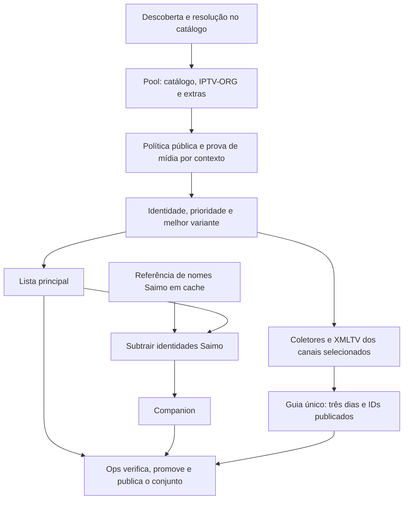

# Entrega: principal, Companion, EPG e Ops 1.2.0

Consolidado em **16/11/2026**, sobre a implementação e as verificações de
14–15/11. Este documento descreve código entregue e evidências datadas; não é
uma nova consulta ao servidor, aos streams ou à programação dos sites.

## 1. Resultado e revisões entregues

| Projeto | Entrega | Commit de implementação |
| --- | --- | --- |
| live-stream-catalog | Descoberta Televisão.TV revisada, bloqueio FrostView, preservação de provedor/headers e persistência atômica | [3ab8bbe02](https://github.com/gambiarras/live-stream-catalog/commit/3ab8bbe02) |
| legal-iptv | Seleção compartilhada, Companion por diferença, validação de mídia, guia único e coletores | [292e87a37](https://github.com/gambiarras/legal-iptv/commit/292e87a37) |
| iptv-ops | Dashboard e operação com limites, agendamento health e versão **1.2.0** | [bc072df](https://github.com/gambiarras/iptv-ops/commit/bc072df) |

Os três commits foram enviados a `origin/main` na entrega. O piloto foi
publicado; não foi executado rebuild/redeploy do container nem verificada a
versão instalada no servidor. Commits de documentação posteriores não alteram
essas revisões de implementação.

### Artefatos públicos

| Arquivo | Função |
| --- | --- |
| [playlist.m3u](https://raw.githubusercontent.com/gambiarras/legal-iptv/main/playlist.m3u) | Lista principal |
| [companion.m3u](https://raw.githubusercontent.com/gambiarras/legal-iptv/main/companion.m3u) | Mesmos critérios e estrutura, somente identidades ausentes no Saimo |
| [guide.xml](https://raw.githubusercontent.com/gambiarras/legal-iptv/main/guide.xml) | Guia canônico compartilhado |
| `companion-guide.xml` | Nome de compatibilidade, com os mesmos bytes do guia canônico |
| `playlist.meta.json`, `companion.meta.json` | Contagens, seleção por fonte, referências e cobertura |
| `companion-youtube.kodi.m3u` | Saída opcional de compatibilidade já existente para o resolvedor YouTube do Kodi |

A Companion regular usa o mesmo exporter, categorias, IDs, cabeçalho EPG e
transportes vencedores da principal. A saída opcional do YouTube não determina
a composição da Companion regular. Não houve alteração ou fork do aplicativo Saimo.

## 2. Fluxo entre os projetos



O catálogo continua responsável pela descoberta/resolução; o gerador decide
identidade, elegibilidade, saúde, EPG e exportação. Ops coordena agenda, arquivos,
recuperação e publicação. O dashboard consulta resumos e páginas de canais;
não faz descoberta nem recebe um XMLTV inteiro a cada atualização.

## 3. Fontes e seleção

A ordem aplicada ao perfil `full` é:

1. **Televisão.TV**: prioridade 900.
2. **Batista Play** (`rest_catalog_1`): 800.
3. **IPTV-ORG**: 700.
4. **YouTube**: 600, quando houver transporte elegível para a saída solicitada.
5. **extra_channels**: 500.

A prioridade atua sobre candidatos utilizáveis do mesmo canal/feed, antes da
qualidade. Dentro da fonte, usa-se a ordem `4K → FHD → HD → SD`, com desempates
de bitrate/estado. A fonte inferior pode recuperar um canal quando a superior
não tem prova válida; não cria outra entrada se já existe um vencedor.

FrostView é bloqueado antes de HTTP/cache no adaptador e antes da publicação
no gerador, inclusive diante de configuração antiga. Opções explicitamente
rotuladas como Alternativo/Backup/Reserva são excluídas. A emissora **TV
Alternativa** permanece válida. Os nomes conhecidos de canais pagos do Batista
são filtrados; isso não transforma o diretório Televisão.TV numa certificação
universal de direitos ou num classificador completo de canais pagos.

Aliases revisados unificam, por exemplo, Sonata TV/TV Sonata e os nomes de
Séries Classic. Qualidade não cria uma nova identidade; afiliada/cidade/região
pode criar. IDs de guia compartilhados por feeds diferentes são tratados
conservadoramente. Foram removidas aproximações que atribuíam grade internacional
ou de outra região sem confirmação. IDs numéricos válidos são preservados.

Deduplicação conserva provedor e contexto de headers. A mesma URL com Referer
diferente não é descartada antes de decidir o vencedor. URLs assinadas,
credenciais, sessões, DRM e resolução dinâmica continuam sujeitas aos limites
de publicação; não são convertidas em URLs públicas permanentes.

### Televisão.TV: o que mudou

O endpoint `channels-data.php` fornece metadados e páginas, não os streams
diretos. `exclude=sbt,tv-brasil` omite esses slugs; não mede qualidade ou saúde.

A investigação inicial obteve 404 em quatro requests isolados. Isso não
comprovava falha dos 371 canais do índice. O fluxo corrigido reutiliza uma
sessão entre home, página, AJAX e iframe declarado. Canal Gov e TV Cultura
forneceram mídia direta; RedeTV apresentou um embed Dailymotion, distinto de
um transporte diretamente publicável.

O default revisado contém seis emissoras: Gov, Cultura, Brasil, Senado,
Câmara e Justiça. Somente Gov e Cultura tinham hosts literais revisados no
piloto; os demais podem permanecer candidatos sem publicação. Não foi
implementado um crawl cego dos 371 players. O operador pode selecionar até
24 slugs revisados. Cache de descoberta v3 inclui revisão de hosts por slug;
TTL seis horas, último resultado válido até 24 horas, quatro fingerprints de
até 8 MB e respostas de até 2 MB.

Detalhes: [contrato Televisão.TV](https://github.com/gambiarras/live-stream-catalog/blob/3ab8bbe02/docs/televisao-source.md).

## 4. Como cada rodada exclui os canais Saimo

A referência usa `catalogo.txt` e `canais.txt` da base
`https://canais-saimo.pages.dev/`, mais o JSON de servidores desativados.
Reproduz a junção relevante do Android e considera visível o canal que ainda
tem fonte habilitada. A comparação usa identidade normalizada/aliases, não
igualdade de URL e não a lista instalada numa TV particular.

O cache guarda nomes e hashes, sem copiar credenciais de transmissão. Cada
geração usa essa referência para subtrair identidades da principal:

```text
Companion = vencedores da principal − identidades visíveis na referência Saimo
```

TTL da referência: **seis horas**. Se a renovação falhar, a última referência
válida pode ser usada por até **48 horas**, preservando sua data original.
Depois disso a geração falha; não publica uma Companion sem filtro. Um canal
novo no Saimo é removido da Companion após a renovação da referência.

A versão 3 da referência não depende do índice Televisão.TV. Caches v2 continuam
legíveis na migração. Essa separação elimina uma requisição e uma dependência
que deixaram de ser necessárias quando a Companion passou a derivar da principal.

## 5. Verificação online/offline e recuperação

HEAD/HTTP 200 e `status=resolved` não bastam. A CLI exige prova recente de mídia
por padrão, usando contexto exato e `probe_version=2`. Um inconclusivo inicial
permanece disponível para rechecagem, mas não entra na playlist nem mascara
uma alternativa comprovada.

A sonda usa GET limitado: interpreta HLS, escolhe uma variante de menor
bandwidth e amostra imediatamente um segmento. Se o último não está disponível,
tenta o penúltimo dentro do mesmo orçamento. Reconhece TS e fMP4; não decodifica
imagem/áudio nem detecta congelamento como um player em execução.

| Limite | Implementação |
| --- | --- |
| Requisições | Até oito GETs por contexto, com prazo compartilhado |
| Manifesto | Até 256 KiB |
| Inicialização/segmento | Até 64 KiB; nenhuma mídia é persistida |
| Concorrência | Até 32 trabalhadores; sessões reutilizadas e fechadas no fim do lote |
| Estado | Até 10.000 contextos e 5.000 tombstones de extras; excesso falha explicitamente |

HTML/JSON 200 e mídia vazia reprovam. Erros de rede/429/5xx são inconclusivos;
DASH, criptografia e formatos não reconhecidos têm motivo próprio. Limitações
do sampler não são inventadas como prova de offline. Redirects não encaminham
headers privados para outra origem.

Uma rejeição não desaparece porque `next_check_at` venceu. Readmissão exige
novo sucesso real. A primeira falha inconclusiva após sucesso comprovado pode
usar `last_media_success_at` por até 24 horas, sem renovar o timestamp. Duas
falhas ou rejeição impedem essa reutilização. HEAD legado não qualifica como
prova forte. Tombstones de extras sobrevivem quando o canal foi omitido do lote;
404 de segmento não equivale a 404 definitivo da URL raiz.

O Chespirito deixou de ser publicado no piloto; isso não é uma promessa sobre
seu estado futuro. Detalhes: [validação e readmissão](stream-validation.md).

## 6. Guia único e coletores

As duas M3Us anunciam **nosso `guide.xml` primeiro**, seguido dos fallbacks
externos deduplicados, incluindo Open EPG. O guia declara todos os IDs da
principal; a Companion compartilha esse conjunto maior. Declaração de canal
não significa existência de programas.

O XMLTV público contém apenas IDs selecionados e a janela de três dias.
Providers têm precedência por canal/intervalo: uma grade oficial parcial vale
nos intervalos publicados, e fontes inferiores podem preencher lacunas sem
sobreposição. Não são inventados horários/episódios para encobrir ausência.
Fox Kids, quando publicado, exige programa atual e futuro.

| Fonte/canal | Implementado e observado em 15/11 |
| --- | --- |
| Fox Kids | XMLTV atual ou catálogo declarado pelo blog/GitHub; rejeita XML vencido, usa séries/blocos sem episódios inventados |
| TV Sonata | Grade oficial datada, com início/fim; três blocos no dia 15, dia 16 vazio no snapshot; fuso configurado explicitamente |
| Nova TVI Petrópolis | Stream dos extras validado; página semanal vazia, sem programação fabricada |
| Correio da Manhã | Identidade YouTube confirmada pelo site brasileiro; já estava na descoberta/saída opcional, sem grade linear datada localizada |
| Open EPG | Acrescentado aos XMLTV de fallback, com reconciliação de IDs |
| MeuGuia | Mapa de IDs/nomes exatos, consultas somente dos canais selecionados, cache e orçamento de páginas |
| GuiaDeTV | Parser e configuração disponíveis; opt-in documentado, sem presumir autorização pública irrestrita de republicação |

O processamento é em fluxo, inclusive gzip, mantendo programas relevantes.
O inventário privado de IDs/nomes permite reconciliar aliases sem conservar
um XML mundial em memória. A seleção final é normalizada antes de calcular o
fingerprint do guia, evitando reconstruções alternadas a cada rodada.

Mantêm-se títulos, subtítulos, categorias, episódios fornecidos, ícones, datas
e classificação. Sinopses longas/créditos são omitidos no guia compacto; a
redução medida não vem apenas do recorte de canais. `companion-guide.xml` é um
alias com bytes idênticos, preferencialmente por hardlink, não outra coleta.

Detalhes, flags, fontes e condições observadas: [coletores EPG](epg-collectors.md).

## 7. Memória, disco e integridade

| Recurso | Default |
| --- | ---: |
| Cache EPG privado | 256 MiB, 96 arquivos, idade máxima 48 h |
| Upstream individual e XML decodificado | 128 MiB, também limitado à metade do orçamento de cache |
| Espaço livre mínimo | 200 MiB |
| Resíduos de falha/interrupção | Até 200 manifests pequenos por sete dias; payloads removidos |
| Dashboard | 100 canais/página, até 512 KiB/resposta e 64 KiB de log |

Caches úteis atravessam rodadas com data original. Arquivos imutáveis usam
hardlinks em seed/backup/promoção quando suportado; escrita sempre por
temporário + substituição, sem alterar o inode retido. XML/JSON inválido não
substitui o cache válido; JSON/XML e arquivos temporários têm limpeza em
`finally`. Há poda por bytes/idade/quantidade e verificação de espaço livre.

Ops recupera promoções interrompidas sob lock antes da limpeza. Um journal
`promoting` é preservado até recuperação. Candidatos grandes de falhas e sucessos
não ficam acumulando em `.runs`. Estado privado, headers sensíveis e payloads brutos não
entram na allowlist Git. Caches brutos não têm rota de download. O Ops preserva
downloads de `stream-status.json` e logs para administração, protegidos pela
autenticação quando configurada. A configuração instalada não foi inspecionada;
esses arquivos não devem ser confundidos com os artefatos públicos do GitHub.
Headers públicos seguros necessários à reprodução podem constar nos artefatos.

Esses limites não equivalem a um teto para todo o volume: histórico Git,
camadas Docker e logs antigos podem ocupar disco independentemente do cache.
Não foi realizada limpeza destrutiva desses dados no servidor.

## 8. Dashboard e operação 1.2.0

O dashboard ganhou layout responsivo claro/escuro, busca, paginação, resumos
separados de principal/Companion, estado das verificações e downloads. Assets
CSS/JS ficam separados do servidor HTTP e não dependem de CDN de interface.

O polling passou a ser serial, cancelável e limitado, com pausa em aba oculta
ou ao sair da página. Atualização manual funciona com o automático desligado.
Leituras são limitadas ao tamanho do arquivo aberto; downloads usam blocos
e respeitam o mesmo inode durante renames de publicação/crescimento de logs.

| Modo | Agenda/efeito |
| --- | --- |
| `refresh` | Cada 30 minutos; atualiza catálogo e gera listas, validando contextos devidos |
| `build` | Minuto 5 a cada seis horas; descoberta completa e geração com checks devidos |
| `health` | Minutos 7, 22, 37 e 52; apenas devidos, fontes/referência/EPG locais, sem redescoberta |
| `validate` / `all` | Permanecem disponíveis manualmente |

Os jobs compartilham lock. Build/refresh fazem a migração de HEAD legado e
verificam novos transportes antes da publicação. Health pode encerrar cedo
quando nada venceu e falha com segurança se faltam caches obrigatórios.

O conjunto é gerado, verificado, selado e promovido antes de publicar. O gate
recusa IDs mundiais alheios no guia, declarações ausentes, divergência de alias,
contagens inconsistentes e falta de EPG obrigatório. Promoção é arquivo a
arquivo com recuperação local; dois pushes Git não formam uma transação única.

A regra de atualizar `VERSION` por entrega ficou em `iptv-ops/AGENTS.md`.
Detalhes: [README Ops](https://github.com/gambiarras/iptv-ops/blob/bc072df/README.md).

## 9. Evidências e limites dos testes

Snapshot verificado em **15/11/2026, 04:55 UTC**:

| Medida | Resultado |
| --- | ---: |
| Principal / Companion | 294 / 229 canais |
| Provedores vencedores | Televisão 2; Batista 133; IPTV-ORG 149; extras 10 |
| Sobreposição Companion/Saimo / duplicatas de identidade | 0 / 0 |
| Guia | 995.025 bytes, 294 declarações, 3.604 programas |
| Canais com programas | 44; os demais têm declaração sem grade inventada |
| Fox Kids / Sonata / Nova TVI | 114 / 3 / 0 programas |
| Geração com cache estabilizado | 0,538 segundo |
| Cache EPG privado observado | Aproximadamente 106 MB, abaixo do teto configurado |

A projeção isolada de um XML de 96.291.985 bytes levou 3,828 s, com pico RSS
de 46.907.392 bytes no processo de teste. Essa medição usou seleção e campos
compactados diferentes do artefato final; não é medição do container/browser.

As suítes tiveram **466 testes aprovados**: 275 legal, 101 catálogo e 90 Ops;
duas integrações opcionais de rede foram ignoradas. Também houve piloto real
com GETs limitados, verificação dos artefatos e confirmação de pushes. Não
somar testes intermediários como testes adicionais.

No Chrome, 389 polls acelerados mantiveram uma fetch simultânea, no máximo
dois timers, DOM estável com 857 elementos/100 linhas e zero timers após saída.
Heap após GC mudou de cerca de 610 para 664 KB. O incidente Firefox de 8 GB
foi relatado pelo usuário e **não foi reproduzido**; não se atribui causa
exclusiva nem se promete estabilidade indefinida com base nesse teste curto.

Evidência estruturada: [evolution-2026-11-15.json](pilot-evidence/evolution-2026-11-15.json).
As contagens acima são fotos datadas e não devem ser usadas como SLA ou
disponibilidade ao vivo. A validação não incluiu reprodução contínua numa TV.

## 10. Ativação, manutenção e recuperação

1. Usar versões coordenadas dos três projetos. Confirmar os commits/pacotes
   esperados antes da primeira execução; os novos flags exigem gerador compatível.
2. Preservar o volume `/workspace`, caches privados e journals. Não apagar
   estado para fazer canais reprovados reaparecerem.
3. Revisar os nomes das configurações e overrides persistidos, sem publicar
   valores privados. Override antigo tem precedência sobre novos defaults;
   `LIVE_TELEVISAO_SLUGS=` desativa explicitamente essa descoberta.
4. Rebuild/redeploy da imagem Ops e recarregar a página. Confirmar versão
   **1.2.0** no dashboard e presença do job health. Push não atualiza a imagem.
5. Conferir fases de geração/verificação/promoção, URLs públicas, primeiro
   guia e cobertura necessária. Comandos operacionais são mutantes; os exemplos
   do README Ops são para execução deliberada, não diagnóstico somente leitura.

Se houver promoção interrompida, usar a recuperação sob o mesmo lock antes
de trocar a imagem. Rollback do container não reverte commits já publicados;
preservar histórico e tratar reversão pública como uma ação separada. Não
houve deploy ou rollback nesta entrega.

Diagnóstico: canal ausente exige conferir política, contexto/última prova e
expiração; Companion incorreta exige revisar referência/aliases Saimo; EPG
vazio exige verificar ID, fuso e programas datados, não apenas a declaração.
Espaço insuficiente exige inspecionar caches e journals preservando recuperação.

## 11. Histórico e escopo que permaneceu separado

O piloto de 14/11 era uma seleção estreita (69 HTTP e nove links opcionais).
A entrega posterior passou a derivar a Companion da principal, sem exigir
presença no diretório Televisão.TV; isso explica os 229 canais do snapshot final.

O código Android Saimo 3.0.5 foi baixado e comparado com a revisão anterior:
308 arquivos conferidos contra hashes Git, commit `b4260a2`. Novidades de VOD
e addons não foram transformadas em fontes estáticas de TV. A limitação de EPG
nas listas pessoais foi documentada, mas o usuário retirou essa integração
do escopo. Não houve build/execução de APK Saimo ou modificação do aplicativo.

A investigação de Saimo tem relatório próprio no workspace. Não foram incluídos
APKs, payloads de streams, estados privados ou dumps nos commits desta entrega.
A investigação não certifica segurança de aplicativos nem concede direitos
de retransmissão.

Pendências distintas da entrega: ativação real no servidor, observação longa
no Firefox/TV e cobertura de canais cujas fontes não oferecem programação.
